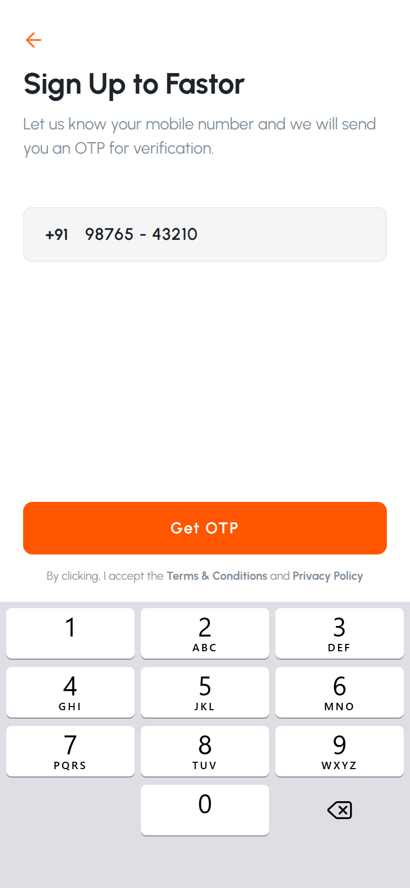
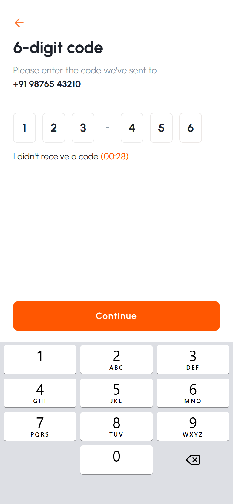
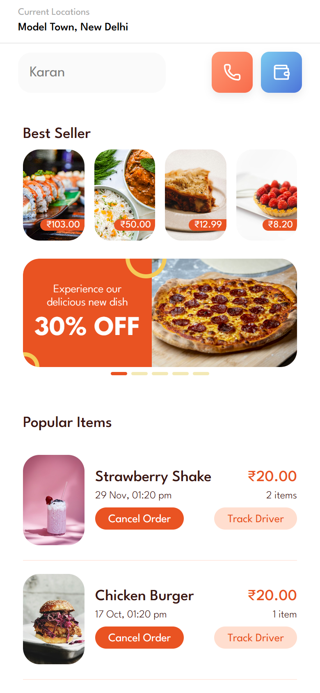
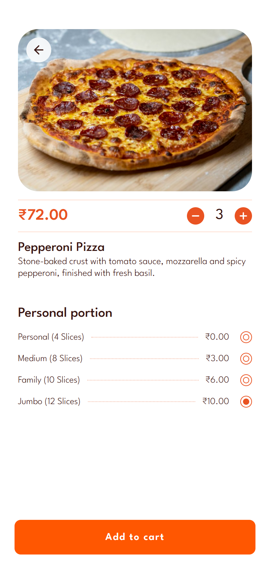

<div align="center">


<h1>Fastor</h1>

<p>
A mobile-first React build of the <b>Fastor</b> Figma design.<br />
Sign up with a mobile number, verify a 6-digit OTP, browse dishes and offers, and customise an order.
</p>

<p>


</p>

</div>

<table>
  <tr>
    <td align="center"><br /><b>Sign up</b></td>
    <td align="center"><br /><b>6-digit code</b></td>
    <td align="center"><br /><b>Home</b></td>
    <td align="center"><br /><b>Product</b></td>
  </tr>
</table>

## ✨ Features

- **Sign up**: `+91` mobile number with live formatting (`98765 - 43210`) and an iOS-style number keypad, as in the design. Validates a 10-digit Indian number (starts with 6–9).
- **OTP**: six boxes with a blinking cursor, a `00:30` resend countdown, and paste / SMS autofill support.
- **Home**: location header, Best Seller row, an auto-sliding offer banner with dots, and Popular Items with **Cancel Order** and **Track Driver**.
- **Product**: quantity stepper and portion options; the price updates live (base + portion × quantity). **Add to cart** confirms with a toast.
- **Login state** is kept after a reload. Home and product pages need login; opening them logged out goes back to sign up.
- **Responsive**: built for phones (tested at 360–430px). On a desktop browser the app is shown as a centered phone-width column.

## 🚀 Getting started

**Prerequisites:** Node.js 20+

```bash
git clone https://github.com/himanshu60/fastor-react-app.git
cd fastor-react-app
npm install
npm run dev
```

Open `http://localhost:5173`. For the best view, use your browser's device mode (for example iPhone 12 Pro, 390 × 844).

> [!NOTE]
> This is a front-end task with no backend, so no SMS is sent. Use any 10-digit number starting with 6–9, then **any 6-digit code**.

## 🧭 Screens and routes

| Screen | Route | Login needed |
|---|---|---|
| Sign up | `/` | No |
| 6-digit code | `/verify` | No (needs a number from sign up) |
| Home | `/home` | Yes |
| Product | `/product/:id` | Yes |

## 🎨 Matching the Figma

The colors, fonts and sizes were measured from the Figma frames:

| | Sign up / OTP | Home / Product |
|---|---|---|
| Font | Urbanist | League Spartan |
| Text | `#1E232C`, muted `#8391A1` | brown `#391713` |
| Accent | orange `#FF5701` | orange `#E95322`, soft `#FFDECF`, yellow `#F5CB58` |

Small, deliberate differences from the Figma:

- The phone status bar (`9:41`) and home indicator are device UI, so the web app doesn't draw them.
- Food photos are free [Unsplash](https://unsplash.com/license) photos of the same dishes (see credits below).
- Prices use **₹** everywhere (the design mixes `$` and `₹`), and the portion labels read "Slices" and "Family".
- The product page has a small back button over the photo, since the design has no way to go back.
- **Get OTP** and **Continue** stay orange as in the design. If pressed too early they explain what is missing instead of being disabled.

## 🧱 Implementation notes

- **Keypad input**: inputs use `inputMode="none"`, so the phone's own keyboard doesn't open on top of the design's keypad. A shared `useDigitInput` hook handles the on-screen keypad, a physical keyboard and paste. It also makes Backspace skip over the formatting characters.
- **OTP boxes**: an invisible `<input>` sits on top of the six boxes, so typing, paste and `autocomplete="one-time-code"` all work.
- **Auth**: `AuthProvider` keeps the number waiting for its OTP in `sessionStorage` and the logged-in number in `localStorage`. `RequireAuth` guards `/home` and `/product/:id`.
- **Data**: dishes, offers and orders are sample data in `src/data/menu.js`.

<details>
<summary><b>Project structure</b></summary>

```
src/
├── assets/images/        # food photos
├── components/
│   ├── BackButton.jsx
│   ├── Keypad.jsx        # iOS-style number pad
│   ├── PromoCarousel.jsx # offer banner with dots
│   ├── RequireAuth.jsx   # route guard
│   ├── ScrollToTop.jsx
│   └── Toast.jsx
├── context/              # AuthContext + AuthProvider
├── data/menu.js          # sample dishes, offers, orders
├── hooks/useDigitInput.js
├── pages/                # SignUp, VerifyOtp, Home, ProductDetail
├── styles/               # auth.css, home.css, product.css
├── utils/format.js       # price and phone formatting
├── App.jsx               # routes
├── main.jsx
└── index.css             # design tokens + shared styles
```

</details>

## 📜 Scripts

| Command | What it does |
|---|---|
| `npm run dev` | Start the dev server |
| `npm run build` | Production build into `dist/` |
| `npm run preview` | Preview the production build |
| `npm run lint` | Run ESLint |

## 📷 Photo credits

Food photos from Unsplash, free to use under the [Unsplash License](https://unsplash.com/license):
[pepperoni pizza](https://unsplash.com/photos/w1iMfs6yxuo) ·
[strawberry milkshake](https://unsplash.com/photos/smsivJclnQM) ·
[chicken burger](https://unsplash.com/photos/pLKgCsBOiw4) ·
[salmon sushi](https://unsplash.com/photos/-1GEAA8q3wk) ·
[lasagna](https://unsplash.com/photos/f5hCsmthZ1I) ·
[chicken curry](https://unsplash.com/photos/gk7XY0YWg-Q) ·
[raspberry tart](https://unsplash.com/photos/JVK7ssGd1qc)
